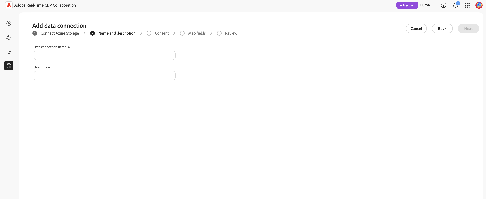

# Configurar el almacenamiento de [!DNL Azure] para la fuente de exposición de publicidad

Conecte su cuenta de [!DNL Azure Data Lake Storage] o [!DNL Azure Blob Storage] a Adobe Real-Time CDP Collaboration con los datos de exposición de publicidad de origen (registro de publicidad) para realizar la medición.

El módulo Medición de Real-Time CDP Collaboration conecta los datos de conversión del anunciante con los registros de exposición de anuncios del publicador para ofrecer informes de campaña centrados en la privacidad. Esto agrega una ruta de autoservicio sin código para anunciantes y editores. Puede incluir los registros de exposición (impresión) de anuncios que ya mantiene en [!DNL Azure] en Medición para atribución, sin dependencia de Adobe Experience Platform. Al conectar una cuenta de almacenamiento, un contenedor y una ruta, confirmar que los datos detectados coinciden con el esquema de registro de anuncios que Measurement espera y finalizan en minutos.

Los datos no se extraen en el momento de la conexión. El abastecimiento se activa al ejecutar un informe de medición. Para minimizar el almacenamiento, Adobe elimina automáticamente los registros de anuncios de origen después de un periodo de retención de 7 días.

Las reglas de administración y administración de datos para los registros de anuncios procedentes de [!DNL Azure] coinciden con las reglas que se aplican a los datos procedentes de Adobe Experience Platform.

>[!NOTE]
>
>Esta guía describe cómo obtener los registros de anuncios **del anunciante y el publicador** (exposiciones de publicidad) del almacenamiento en la nube. El abastecimiento de datos de conversión desde el almacenamiento en la nube estará disponible próximamente.

## Requisitos previos {#prerequisites}

Complete todos los elementos de esta sección antes de iniciar el flujo de trabajo de configuración. Antes de seguir esta guía, debes haber completado la [incorporación y configuración de la cuenta](./onboard-account.md).

### Acceso y permisos de [!DNL Azure] {#azure-access-and-permissions}

Usted o el administrador de [!DNL Azure] deben poder asignar el rol de **[!DNL Storage Blob Data Reader]** en su cuenta de almacenamiento durante el paso de **[!UICONTROL Consentimiento]** del asistente. Consulte [Conectar registros de anuncios en el asistente](#connect-adlogs).

### Preparar los datos de registro de anuncios {#prepare-adlog-data}

Los archivos de registro de anuncios deben cumplir con el [esquema de registro de anuncios](#ad-log-schema) antes de que comience el abastecimiento. Los requisitos clave incluyen:

* **Formato de archivo:** CSV solamente.
* **Encabezados de columna canónicos:** Los archivos deben utilizar los encabezados de columna canónicos definidos en el [esquema de registro de anuncios](#ad-log-schema). Esta versión no admite la reasignación por columna ni la asignación de esquema automatizada.
* **Campos obligatorios:** Todos los campos obligatorios deben estar presentes, junto con al menos una clave de coincidencia.
* **Hash de clave de coincidencia:** Los valores de hash de clave de coincidencia deben estar en minúscula hexadecimal SHA-256.
* **Coherencia de columna:** Todos los archivos de la ruta de acceso configurada deben compartir un diseño de columna idéntico.
* **Subcarpetas:** Los archivos deben ubicarse directamente en la ruta de acceso especificada. Collaboration no atraviesa las subcarpetas.

## Conexión de registros de publicidad en el asistente {#connect-adlogs}

Siga estos pasos para conectar los registros de anuncios de [!DNL Azure] desde Collaboration.

1. En el área de trabajo **[!UICONTROL Configuración]**, seleccione **[!UICONTROL Mis datos de medición]**, luego seleccione el icono Agregar y elija **[!UICONTROL Datos de medición]**.

   {zoomable="yes"}

2. En el flujo de trabajo **[!UICONTROL Agregar datos de medición]**, seleccione **[!UICONTROL Exposiciones de Advertising]** como tipo de datos de medición y, a continuación, seleccione **[!UICONTROL Siguiente]**.

   {zoomable="yes"}

3. Para importar sus datos de medición, seleccione **[!UICONTROL Agregar una nueva conexión de datos]** y, a continuación, seleccione **[!UICONTROL Siguiente]**.

   {zoomable="yes"}

4. Seleccione el origen de datos de la nueva conexión de datos: **[!UICONTROL Azure Blob Storage]** o **[!UICONTROL Azure Data Lake Storage Gen 2]**. Seleccione **[!UICONTROL Siguiente]**.

   {zoomable="yes"}

5. Se abre el asistente **[!UICONTROL Agregar conexión de datos]**. En el paso **[!UICONTROL Conectar el almacenamiento de Azure]**, proporcione la **[!UICONTROL cuenta de almacenamiento]**, el **[!UICONTROL contenedor]**, la **[!UICONTROL ruta de acceso]** y el **[!UICONTROL identificador de inquilino]** donde se encuentran los archivos de registro de anuncios. Todos los campos son obligatorios y todos los archivos de la ruta configurada se tratan como un conjunto de datos.

   {zoomable="yes"}

6. En el paso **[!UICONTROL Nombre y descripción]**, proporcione un **[!UICONTROL Nombre de conexión de datos]** (obligatorio) y una **[!UICONTROL Descripción]** opcional para la conexión de datos.

   {zoomable="yes"}

7. En el paso **[!UICONTROL Consentimiento]**, seleccione el icono de inicio situado junto a la **[!UICONTROL URL de consentimiento]** para abrir la página de autorización de [!DNL Azure] y conceder acceso a la aplicación de la lista. Asigne el rol **[!DNL Storage Blob Data Reader]** a esa aplicación en su cuenta de almacenamiento, luego regrese a Collaboration y seleccione **[!UICONTROL Siguiente]** para verificar el acceso.

   >[!NOTE]
   >
   >La asignación de funciones puede tardar unos minutos en propagarse. Si la verificación falla, espera un momento y selecciona **[!UICONTROL Siguiente]** de nuevo.

   {zoomable="yes"}

8. En el paso **[!UICONTROL Asignar campos]**, obtenga una vista previa de las columnas detectadas para confirmar que el asistente lee los archivos correctos y, a continuación, revise el [esquema de registro de anuncios](#ad-log-schema), que enumera todos los campos que Measurement comprende, qué campos son obligatorios frente a los opcionales y qué columnas detectadas se reconocen como claves de identidad o coincidencia. Este paso es de validación de solo lectura: el sistema confirma que los encabezados requeridos están presentes y le bloquea si falta un campo requerido. En esta versión no hay ninguna reasignación por columna.

   {zoomable="yes"}

9. En el paso **[!UICONTROL Revisar]**, revise y finalice. La conexión aparece en el área de datos de medición con su estado, que permanece **pendiente** hasta que el primer informe de medición ejecute los datos de origen.

## Funcionamiento del abastecimiento de registros de publicidad {#how-it-works}

El abastecimiento de registro de anuncios de [!DNL Azure] refleja el flujo de alto nivel que se usa para el abastecimiento de audiencias:

1. **Conexión de almacenamiento en la nube:** configura el acceso de solo lectura a una cuenta o contenedor de almacenamiento que contiene sus registros de anuncios.
2. **Revisión y validación de esquemas:** el sistema valida los archivos con el esquema de registro de anuncios (comprobaciones de carpetas, archivos y encabezados requeridos; sólo lectura).
3. **Asignación de campos:** los campos de identidad de origen se asignan automáticamente a campos canónicos en función de los nombres de columna canónicos. No hay reasignación manual.
4. **Ingesta y normalización:** eventos se normalizan a una fila por exposición. El abastecimiento de registros de anuncios se inicia al ejecutar un informe de medición.

### Esquema de registro de anuncios (formato CSV canónico) {#ad-log-schema}

Los campos obligatorios deben estar presentes y al menos un campo marcado como **Unir clave (obligatorio)** en la siguiente tabla también debe estar presente. Los valores hash de clave de coincidencia son valores hexadecimales SHA-256 en minúsculas.

| Campo | Tipo de datos | Requerido | Descripción |
| --- | --- | --- | --- |
| `EVENT_DATETIME` | Cadena (ISO 8601) | Requerido | Marca de tiempo del evento |
| `EVENT_ID` | Cadena | Opcional | ID único del evento |
| `EVENT_TYPE` | Cadena (enumeración) | Requerido | Tipo de evento. Uno de `{impression, click}` |
| `HASHED_EMAIL_SHA_256` | Cadena (hexadecimal de 64 caracteres) | Clave de unión (una de ellas obligatoria) | SHA-256 hexadecimal en minúsculas del correo electrónico |
| `HASHED_IPV4_SHA_256` | Cadena (hexadecimal de 64 caracteres) | Clave de unión (una de ellas obligatoria) | SHA-256 hexadecimal en minúsculas de IPv4 |
| `DEVICE_ID` | Cadena (hexadecimal de 64 caracteres) | Clave de unión (una de ellas obligatoria) | ID de publicidad del dispositivo |
| `DEVICE_ID_TYPE` | Cadena (enumeración) | Opcional | Uno de `{idfa, gaid, aaid, rida, afai, msai, vida, lgudid, tifa}` |
| `ECID` | Cadena (hexadecimal de 64 caracteres) | Clave de unión (una de ellas obligatoria) | ECID basado en Demdex |
| `CUSTOM_ID` | Cadena | Opcional | ID persistente de publicador/socio (por ejemplo, PPID, RampID, Core ID) |
| `ADVERTISER_ID` | Cadena | Requerido | Identificador único del anunciante |
| `ADVERTISER_NAME` | Cadena | Opcional | Nombre del anunciante/marca |
| `CAMPAIGN_ID` | Cadena | Requerido | Identificador de campaña específico de la plataforma |
| `CAMPAIGN_NAME` | Cadena | Opcional | Nombre de campaña legible en lenguaje natural |
| `PLACEMENT_ID` | Cadena | Requerido | Identificador único de la ubicación |
| `PLACEMENT_NAME` | Cadena | Opcional | Nombre de ubicación descriptivo |
| `CREATIVE_ID` | Cadena | Opcional | Identificador único del creador de la publicidad |
| `CREATIVE_NAME` | Cadena | Opcional | Nombre creativo legible por un ser humano |
| `AUDIENCE_ID` | Cadena | Opcional | Identificador del segmento de audiencia |
| `AUDIENCE_NAME` | Cadena | Opcional | Nombre de audiencia legible en lenguaje natural |
| `DEVICE_TYPE` | Cadena (enumeración) | Opcional | Uno de `{mobile, desktop, tablet, ctv, dooh, car, in_store, other}` |
| `AD_FORMAT` | Cadena (enumeración) | Opcional | Uno de `{display, video, native, audio, search, commerce, dooh, other}` |
| `SITE_NAME` | Cadena | Opcional | Propiedad de red/sitio/aplicación/editor en la que se produjo la impresión |
| `TEST_GROUP` | Cadena | Opcional | Agrupación para estudios de elevación, ensayos/control, grupos de exclusión |
| `CUSTOM_DIM` | Cadena | Opcional | Dimensión de editor adicional |

{style="table-layout:auto"}

>[!NOTE]
>
>`MATCH_KEY_TYPE` se incluye como un campo opcional en el esquema para que, con el tiempo, se puedan admitir varios tipos de ID en paralelo y la procedencia de clave de coincidencia (correo electrónico, teléfono o CRM) se pueda conservar sin romper el contrato de la versión 1.

### Requisitos de validación (v1) {#validation-requirements}

El sistema valida y registra los datos de origen antes de completar el flujo de trabajo de configuración. Comprobaciones de validación:

* La carpeta de origen debe contener al menos un archivo.
* Los archivos no pueden estar vacíos.
* Deben estar presentes los encabezados de esquema requeridos.
* Se pueden omitir los campos de esquema opcionales.
* Los archivos que solo contienen los campos obligatorios son válidos.

Los errores de validación impiden continuar. El sistema **no** valida tipos de datos, valores de campo, integridad de registros, calidad de datos o asignación de esquema automatizada. La validación se limita a las comprobaciones de carpetas, archivos y encabezados requeridos para esta versión inicial.

## Limitaciones conocidas {#known-limitations}

Tenga en cuenta las siguientes restricciones al configurar y utilizar el abastecimiento de registro de anuncios de [!DNL Azure]:

* **Solo registros de anuncios:** Esta conexión genera registros de anuncios de anunciante o editor (exposiciones de publicidad). Los datos de conversión aún no son compatibles.
* **Fuentes compatibles:** [!DNL Azure Data Lake Storage] o [!DNL Azure Blob Storage], y [!DNL Google Cloud Storage].
* **Formato de archivo:** CSV solamente.
* **Se requieren encabezados canónicos:** No hay reasignación por columna ni asignación inteligente/automatizada. Los archivos deben utilizar los nombres de columna canónicos.
* **Sin validación de valor/tipo:** Solo se validan los encabezados de columna requeridos. Inicialmente, es posible que no haya filas de datos.
* **No se puede editar una conexión después de la creación:** Cualquier cambio, incluido el cambio de las claves de coincidencia activas, requiere la creación de una nueva conexión.
* **Un diseño por ruta:** Todos los archivos de la ruta deben compartir un diseño de columna idéntico. Los diseños mixtos pueden provocar errores de abastecimiento parciales.
* **No se han atravesado las subcarpetas:** Los archivos deben sentarse directamente en la ruta de acceso especificada.
* **No hay programación ni retrospectiva en la configuración:** El abastecimiento de registros de anuncios se inicia al ejecutar un informe de medición. Establezca el período retroactivo al configurar el informe.
* **Una conexión de datos de registro de anuncios:** Configure solamente una conexión de datos de registro de anuncios a la vez. Los informes de medición utilizan automáticamente la conexión configurada.

## Resolución de problemas {#troubleshooting}

* **La conexión muestra datos pendientes/no hay datos:** Esto se espera hasta que se ejecute el primer informe de medición. No se obtienen datos en el momento de la conexión.
* **&quot;No se encontraron datos&quot; en el paso de origen:** La carpeta está vacía. Agregue archivos antes de continuar.
* **La vista previa no muestra columnas:** El archivo está presente pero vacío (sin encabezados ni contenido).
* **No se puede obtener la validación posterior:** Falta un encabezado de columna requerido. Confirme que los campos obligatorios y al menos una clave de coincidencia están presentes, utilizando nombres canónicos.
* **Columnas no reconocidas:** Los nombres de columnas no canónicas no se recogen como campos conocidos. Cámbieles el nombre al formato canónico; no hay reasignación en esta versión.
* **Se produce un error en el abastecimiento después de la instalación:** Confirme que el acceso de lectura de Adobe a la cuenta o contenedor de almacenamiento no ha cambiado y que los archivos siguen existiendo en la ruta de acceso configurada en formato canónico.
* **El intervalo de fechas del informe no está completamente cubierto:** Recuerde la caducidad automática de datos de 7 días. Es posible que los registros con más de 7 días no estén disponibles para el intervalo solicitado.

## Consideraciones sobre la actualización o migración {#upgrade-migration}

* Los clientes incorporados anteriormente mediante Experience Platform o la configuración asistida por Adobe pueden pasar a la ruta de almacenamiento en la nube de autoservicio. Los informes de medición y flujos existentes no cambiarán.
* Las claves de coincidencia presentes en los archivos de registro de publicidad deben habilitarse para la cuenta de Collaboration, al igual que con el abastecimiento de audiencias.
* Las reglas de gobernanza y gestión de datos coinciden con los datos procedentes de Experience Platform.

## Próximos pasos {#next-steps}

Una vez finalizado el abastecimiento, los registros de anuncios están disponibles para los informes de medición.

Para ver otros métodos de obtención de la exposición a la publicidad, consulte [Configuración del almacenamiento en la nube de Google para la obtención de la exposición a la publicidad](./configure-gcs-adlog-sourcing.md).
