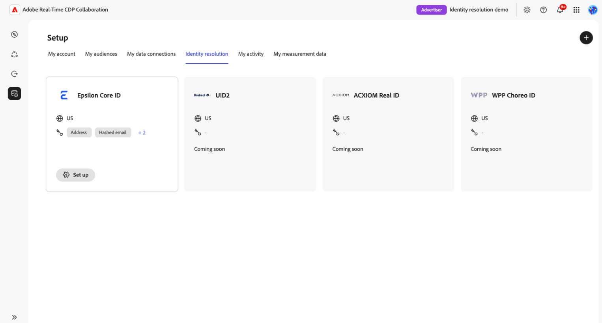

# Configuración y administración de la resolución de identidad

{{limited-availability-release-note}}

La resolución de identidades ayuda a identificar a los clientes que tienen en común con los colaboradores, incluso cuando sus organizaciones utilizan identificadores diferentes. Configure y administre la resolución de identidades con proveedores de identidades admitidos en Real-Time CDP Collaboration, sin crear integraciones personalizadas para cada socio.

>[!NOTE]
>
>Actualmente, solo está disponible el ID principal de Epsilon para la configuración y solo para las cuentas de Real-Time CDP Collaboration aprovisionadas en Estados Unidos. Los pasos y capturas de pantalla de esta guía utilizan el ID principal de Epsilon.

## Requisitos previos {#prerequisites}

Antes de empezar, asegúrese de que dispone de lo siguiente:

* **Permisos de administración de cuentas.** Debe tener los permisos de **[!UICONTROL Administrar cuenta]** y **[!UICONTROL Administrar instancias de Collaboration]**.
* **Al menos una conexión de datos de audiencia.** Necesita una conexión de datos de audiencia existente para configurar la resolución de identidad. [Configure el abastecimiento de audiencia](./source-overview.md) si es necesario. No se admiten conexiones de datos de medición.
* **Campos y claves de coincidencia admitidos.** Cada conexión de datos de audiencia que pretenda utilizar para la resolución de identidades debe contener campos admitidos por su proveedor de identidad. Para el ID principal de Epsilon, puede utilizar un correo electrónico con hash, un teléfono con hash o un nombre combinado con una dirección postal.

  Las claves de coincidencia a nivel de cuenta, como el correo electrónico con hash y el teléfono con hash, deben habilitarse para su cuenta y asignarse a los datos de audiencia. Los campos Nombre y Dirección postal se asignan durante la configuración de la conexión de datos de audiencia y no requieren la habilitación a nivel de cuenta.

  Si utiliza un nombre y una dirección postal, asigne al menos un campo de cada grupo:

  * **Nombre:** Nombre, apellido o nombre completo.
  * **Dirección postal:** Dirección de calle, ciudad, código postal, estado o país.

  Los valores de nombre y dirección postal no tienen hash. Para obtener instrucciones sobre cómo habilitar las claves de coincidencia a nivel de cuenta, como el correo electrónico con hash y el teléfono con hash, consulte [Editar claves de coincidencia](./onboard-account.md#edit-match-keys). Para asignar claves de coincidencia admitidas o campos de nombre y dirección postal a los datos de audiencia, consulte [Asignar campos](./onboard-audiences.md#map-fields).
* **Número de cuenta Epsilon.** Obtenga su número de cuenta de Epsilon de su representante de cuentas de Epsilon.

## Configurar la resolución de identidad {#configure-identity-resolution}

Seleccione un proveedor de identidad para comenzar a configurar la resolución de identidades. En este ejemplo de [!DNL Epsilon Core ID], se autenticará con el proveedor, seleccionará conexiones de datos de audiencia, establecerá un intervalo de fechas y revisará la configuración antes de confirmar.

Para empezar, seleccione **[!UICONTROL Setup]** en el panel de navegación izquierdo seguido de la ficha **[!UICONTROL Identity resolution]** para ver los proveedores de identidad disponibles.

### Seleccionar un proveedor de identidad {#select-identity-provider}

Busque la tarjeta de su proveedor de identidad y revise su región admitida y las claves de coincidencia. Seleccione **[!UICONTROL Configuración]** para comenzar.

{zoomable="yes"}

Antes de iniciar el flujo de trabajo de configuración, Collaboration comprueba la existencia de una conexión de datos y de claves de coincidencia compatibles. Si falta un requisito, aparece un cuadro de diálogo para guiar el proceso. Siga la acción del cuadro de diálogo:

* **[!UICONTROL Se requiere conexión de datos]:** Seleccione **[!UICONTROL Configurar conexión de datos]** para configurar una conexión de datos de audiencia. Ver [Conectar un origen](./source-overview.md#connect-a-source).
* **[!UICONTROL Se requiere una clave de coincidencia]:** Seleccione **[!UICONTROL Editar claves de coincidencia]** para habilitar una clave admitida. Ver [Editar claves de coincidencia](./onboard-account.md#edit-match-keys).

Si faltan ambos, aparecerá primero el cuadro de diálogo de conexión de datos. Después de corregir los requisitos previos, vuelva a **[!UICONTROL Resolución de identidad]** y seleccione de nuevo **[!UICONTROL Configuración]**.

### Autenticar con su proveedor de identidad {#authenticate-with-provider}

En el paso **[!UICONTROL Autenticar]**, proporcione la información requerida por su proveedor de identidad. Para el ID principal de Epsilon, ingrese el número de cuenta proporcionado por su representante de Epsilon en el campo **[!UICONTROL Número de cuenta de Epsilon]**. Haga clic en **[!UICONTROL Siguiente]** para continuar.

{zoomable="yes"}

### Seleccionar conexiones de datos {#select-data-connections}

A continuación, elija qué conexiones de datos de audiencia desea utilizar para la resolución de identidades. Esto determina qué datos de audiencia se utilizarán para hacer coincidir las identidades de los clientes con las del proveedor de identidad. La resolución de identidad utiliza automáticamente los identificadores admitidos asignados en cada conexión seleccionada.
A continuación, elija qué conexiones de datos de audiencia desea utilizar para la resolución de identidades. Las conexiones seleccionadas determinan qué datos de audiencia y campos asignados están disponibles para la resolución de identidades.

La resolución de identidad se aplica a todas las audiencias de cada conexión de datos seleccionada, incluidas las audiencias añadidas posteriormente. No puede seleccionar audiencias individuales en este momento.

Si la conexión que desea no aparece en la lista, [configure la conexión de datos de audiencia](./source-overview.md) antes de continuar.

En **[!UICONTROL Orígenes de datos]**, active la casilla de verificación de cada conexión que desee incluir en **[!UICONTROL Orígenes de audiencias]**. Debe seleccionar al menos una conexión. Haga clic en **[!UICONTROL Siguiente]** para continuar.

{zoomable="yes"}

### Establecer una programación de resolución de identidad {#set-schedule}

Elija las fechas de inicio y finalización para definir el periodo durante el cual Adobe actualiza los ID de socio. La frecuencia de actualización viene determinada por las conexiones de datos de audiencia seleccionadas, por lo que no puede configurar una frecuencia de actualización independiente para la resolución de identidades.

En el paso **[!UICONTROL Programar]**, seleccione el control de calendario en **[!UICONTROL Intervalo de fechas]** y elija las fechas. Haga clic en **[!UICONTROL Siguiente]** para continuar.

{zoomable="yes"}

### Revise y confirme la configuración {#review-and-confirm}

En el paso **[!UICONTROL Revisar]**, comprueba los detalles de autenticación, las conexiones de datos de audiencia seleccionadas y la programación. Para hacer cambios, selecciona **[!UICONTROL Editar]** junto a la sección correspondiente.

No puede editar la configuración después de la instalación. Para realizar cambios más adelante, debe eliminarla y volver a configurarla. Una vez que esté satisfecho con sus selecciones, seleccione **[!UICONTROL Confirmar y programar]**.

{zoomable="yes"}

Un cuadro de diálogo de confirmación indica que la resolución de identidad se ha configurado correctamente.

<!-- [Question: Does the first identity resolution run happen immediately after setup, or at the next scheduled audience data connection refresh?] -->

## Administrar resolución de identidad {#manage-identity-resolution}

Después de confirmar la instalación, volverá automáticamente a la ficha **[!UICONTROL Resolución de identidad]**, donde podrá ver o eliminar la configuración.

### Ver detalles de configuración {#view-configuration-details}

Para revisar tu configuración, selecciona **[!UICONTROL Ver detalles]** en la tarjeta de tu proveedor de identidad configurado.

Revise los detalles de autenticación, las conexiones de datos de audiencia seleccionadas y el intervalo de fechas. También puede ver las claves de coincidencia mostradas en los detalles de configuración, junto con el estado de configuración y la información de creación y actualización.

{zoomable="yes"}

### Cambiar una configuración existente {#edit-configuration}

No puede editar una configuración de Core ID después de la instalación. Para cambiar el número de cuenta Epsilon, las conexiones de datos seleccionadas o el intervalo de fechas, [elimina la configuración](#delete-configuration) y completa de nuevo el [flujo de trabajo de instalación](#configure-identity-resolution).

<!-- Question: Do other providers have the same limitation? -->

### Eliminar una configuración de resolución de identidad {#delete-configuration}

Para eliminar una configuración, ve a **[!UICONTROL Configuración]** > **[!UICONTROL Resolución de identidad]** y selecciona **[!UICONTROL Eliminar]** en la tarjeta del proveedor de identidad configurado. Revise el cuadro de diálogo de confirmación y, a continuación, seleccione **[!UICONTROL Eliminar]** para confirmar.

Si quieres volver a usar este proveedor de identidad, tendrás que [configurar una nueva configuración](#configure-identity-resolution).

<!-- [UNVERIFIED: Does deletion affect previously resolved identifiers, future processing, or both? Confirm before publication.] -->

## Solucionar problemas de configuración {#troubleshoot}

Si no puede comenzar la instalación porque falta una conexión de datos o una clave de coincidencia, siga las instrucciones de [Seleccionar un proveedor de identidad](#select-identity-provider).

Para el ID principal de Epsilon, compruebe lo siguiente:

* **No disponible en su región:** El identificador principal de Epsilon solo está disponible para las cuentas de Collaboration aprovisionadas en los Estados Unidos.
* **Número de cuenta de Epsilon no disponible:** Póngase en contacto con su representante de Epsilon para obtener su número de cuenta.
