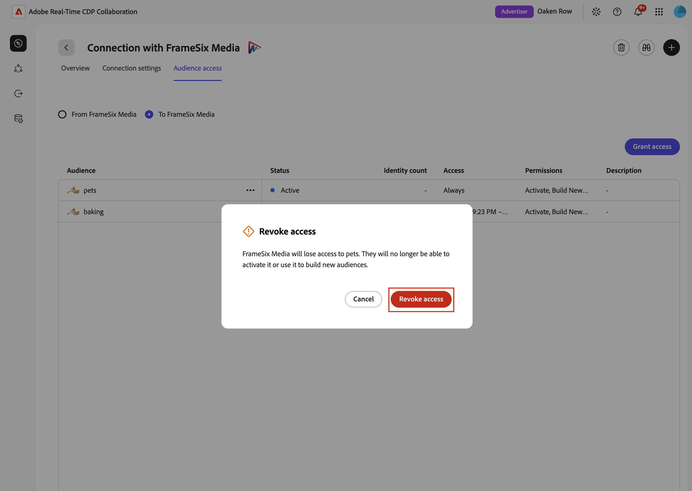

# Acceso de audiencia virtual (concesiones de audiencia) para RMN {#virtual-audience-access}

Para compartir audiencias con socios conectados, use el acceso a audiencias virtuales en [!DNL Adobe Real-Time CDP Collaboration]. Una concesión de audiencia proporciona al socio acceso a toda la población de audiencia a través de una referencia persistente. Se conserva la propiedad y no se mueven datos de audiencia al conceder el acceso.

Para utilizar una audiencia compartida, busque la audiencia virtual en su inventario. Utilice la audiencia para la activación o la creación de audiencias de cohorte dentro de los permisos de concesión. Por ejemplo, una red de medios minoristas (RMN) puede otorgar a los anunciantes acceso para la creación y activación de audiencias de cohorte.

## Conceptos de acceso de audiencia {#audience-access-concepts}

Para comprender lo que comparte y cómo un socio puede utilizar la audiencia, revise los siguientes términos.

| Término | Descripción |
| --- | --- |
| Proveedor | La organización propietaria de la audiencia y que controla el acceso. |
| Destinatario | El socio conectado que recibe acceso a la audiencia. |
| Conceder | Acceso a una audiencia compartida, incluidos los usos permitidos y la duración del acceso. |
| Audiencia virtual | Una referencia persistente a una audiencia propiedad del proveedor, disponible en el inventario de destinatarios. |
| Población completa | Uso compartido que concede acceso a toda la población de audiencias. |
| Ámbito de conexión | Acceso que se aplica a la conexión entre el proveedor y el destinatario, en lugar de a un solo proyecto. |

{style="table-layout:auto"}

Para activar una audiencia compartida, necesita permiso de activación directa.

El acceso de audiencia virtual se aplica a una conexión. El uso compartido dentro de un proyecto es un flujo de trabajo independiente y no agrega audiencias virtuales al inventario de destinatarios.

Para activar audiencias a través de un proyecto de colaboración existente, consulte [Enviar y activar audiencias en un proyecto](/help/guide/collaborate/activate.md).

## Requisitos previos {#prerequisites}

Antes de conceder o utilizar el acceso de audiencia virtual, confirme que cumple los siguientes requisitos.

* Para las concesiones de audiencia virtual, establece una [conexión activa con tu colaborador](/help/guide/connect/establishing-connections.md).
* Si proporciona una audiencia, confirme que la audiencia está disponible para compartir.
* Para confirmar qué acciones están disponibles, revise los permisos de concesión para audiencias compartidas con usted.

El cuadro de diálogo **[!UICONTROL Compartir audiencias]** muestra los siguientes permisos. Ambos permisos están seleccionados y no están disponibles para editar.

| Permiso de audiencia | Uso permitido |
| --- | --- |
| Activación directa | Activar una audiencia compartida en un destino sin proyecto cuando la audiencia cumpla los requisitos de activación. |
| [!UICONTROL Crear nueva audiencia] | Utilice una audiencia compartida como entrada al crear audiencias. |

{style="table-layout:auto"}

## Compartir una audiencia {#share-an-audience}

Para proporcionar a un socio conectado acceso a audiencias seleccionadas, conceda acceso a toda la población y establezca los usos y la duración permitidos. Conceder acceso no activa las audiencias.

En primer lugar, abra el espacio de trabajo **[!UICONTROL Connect]** y la conexión del destinatario.

A continuación, seleccione **[!UICONTROL Acceso de audiencia]** y elija la opción para las audiencias que comparta con el socio.

La opción incluye el nombre del socio. En este ejemplo, seleccione **[!UICONTROL Para FrameSix Media]**.

A continuación, seleccione **[!UICONTROL Conceder acceso]** para abrir el cuadro de diálogo **[!UICONTROL Compartir audiencias]**.

En **[!UICONTROL Audiencias]**, elija audiencias de **[!UICONTROL Seleccionar audiencias]** o seleccione **[!UICONTROL Examinar audiencias]**.

Las audiencias seleccionadas aparecerán en el cuadro de diálogo. Su organización conserva la propiedad y administración de las audiencias.

A continuación, revise los permisos mostrados en **[!UICONTROL Permiso]**. El permiso de activación directa permite al socio activar audiencias virtuales en sus propios destinos. **[!UICONTROL Crear nueva audiencia]** permite que el socio use audiencias virtuales para crear nuevas audiencias. Ambos permisos están seleccionados y no están disponibles para editar.

A continuación, elija una opción de **[!UICONTROL Duración]** en **[!UICONTROL Duración del acceso]** para establecer cuánto tiempo tiene acceso el socio. Seleccione **[!UICONTROL Siempre]** para obtener acceso sin fecha de caducidad o especifique una fecha para el acceso de tiempo limitado.

Por último, revisa las audiencias, los permisos y la duración del acceso seleccionados y, a continuación, selecciona **[!UICONTROL Conceder acceso]**.

La pestaña **[!UICONTROL Acceso de audiencia]** enumera las audiencias compartidas con su estado, recuento de identidades, duración del acceso, permisos y descripción.

Las audiencias compartidas también aparecen en el inventario de destinatarios como referencias virtuales. Usted conserva la propiedad. El destinatario puede activar una audiencia por separado si la concesión permite la activación.

## Búsqueda y uso de audiencias compartidas {#find-and-use-shared-audiences}

Como destinatario, busque audiencias compartidas en la ficha **[!UICONTROL Acceso de audiencia]** de la conexión del proveedor. Utilice cada audiencia dentro de los permisos de concesión.

### Buscar audiencias compartidas {#find-shared-audiences}

Para buscar audiencias compartidas por un proveedor y revisar sus detalles de acceso, abra la conexión del proveedor. En primer lugar, abra el área de trabajo **[!UICONTROL Connect]** y la conexión del proveedor.

A continuación, seleccione **[!UICONTROL Acceso de audiencia]** y elija la opción para audiencias compartidas por el proveedor.

La opción incluye el nombre del proveedor. En este ejemplo, seleccione **[!UICONTROL De FrameSix Media]**.

Finalmente, revise las audiencias compartidas y sus detalles de acceso.

### Generar públicos {#build-audiences}

Para crear una audiencia a partir de una audiencia compartida, necesita el permiso **[!UICONTROL Crear nueva audiencia]**. Por ejemplo, combine una audiencia compartida con su propia audiencia para crear una nueva.

La nueva audiencia le pertenece. El proveedor conserva la propiedad de la audiencia de origen.

### Activar audiencias compartidas {#activate-shared-audiences}

Para la activación directa de una audiencia virtual, confirme que la subvención cumple estas condiciones.

| Requisito | Condición |
| --- | --- |
| Tipo de uso compartido | Población completa |
| Permiso de audiencia | Tiene permiso de activación directa para la audiencia. |
| Conceder estado | Activo. El acceso es indefinido o se encuentra dentro del intervalo de fechas especificado. |

{style="table-layout:auto"}

Para enviar una audiencia apta a un destino, usa la página **[!UICONTROL Activar]**. No necesita un proyecto.

Para obtener más información, consulte [Activar audiencias directamente (Beta)](/help/guide/destinations/direct-audience-activation.md).

Si una audiencia no cumple los requisitos, no se puede seleccionar para la activación directa. Collaboration vuelve a comprobar la idoneidad en cada ejecución de activación programada.

## Administrar el acceso a audiencias {#manage-audience-access}

Como proveedor, controla cuánto dura el acceso. Solo usted puede cambiar la caducidad de la concesión o revocar el acceso.

### Duración del acceso {#access-duration}

Elija una duración de acceso al crear la concesión.

| Duración | Comportamiento |
| --- | --- |
| [!UICONTROL Siempre] | Access no tiene caducidad automática. Puede revocar la concesión. |
| Intervalo de fecha | El acceso dura para el intervalo de fechas especificado. Collaboration procesa la caducidad cada hora. |

{style="table-layout:auto"}

Para ampliar el acceso, establezca una fecha de caducidad futura o cambie la duración a acceso indefinido. Cualquiera de los cambios también reactiva una concesión caducada.

### Caducidad del acceso {#access-expiration}

Collaboration comprueba las concesiones caducadas cada hora. Cuando Collaboration marca una concesión como caducada, el destinatario pierde el acceso virtual a la audiencia.

### Revocar acceso {#revoke-access}

Para quitar el acceso virtual inmediatamente, revoque la concesión activa o caducada.

## Próximos pasos {#next-steps}

Después de conceder o recibir acceso a la audiencia, utilice las siguientes guías para prepararse para la activación o administrar las conexiones de los colaboradores.

* [Configuración y administración de destinos](/help/guide/destinations/manage-destinations.md)
* [Administrar conexiones de colaborador](/help/guide/connect/manage-connections.md)
